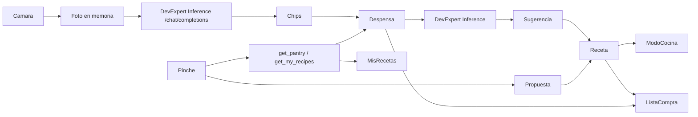

# Descubrimiento técnico

Decisiones técnicas de **What's for Lunch?**. Lo marcado **Confirmado** está fijado por el usuario; el resto es candidato. Las reglas del negocio viven en `docs/domain-model.md`; las validaciones pendientes en `docs/risks-and-open-questions.md` («Tareas de investigación»).

## Superficie del producto

App **Android nativa, solo móvil** (API 30 / Android 11 o superior), un solo repositorio (`P20`, `P24`, Q-arrancar-app-en-mis-recetas-2). Ocho pantallas: Mis Recetas (entrada, `P18`), Escáner, Detalle, Modo Cocina, Pinche, Formulario de Receta, Lista de la Compra y Ajustes. Sin web, tablet ni escritorio en el MVP.

## Punto de partida

El PRD de origen (`chefencasa_prd_y_project_brief_completo.md`) proponía una **PWA React 18/Vite/TS + Tailwind, backend Python FastAPI o Node.js con PostgreSQL, YOLOv8 ONNX y Gemini/Claude**. El usuario fijó un rumbo distinto en las rondas de descubrimiento:

- App **solo Android, Kotlin + Jetpack Compose**, un solo repositorio (`P35`, `P20`, `P24`).
- **Sin backend en el MVP**: datos locales, sesión local, sin cuentas (`P31`, `P33`). FastAPI queda como backend **futuro** (`P34`).
- Detección de alimentos con **IA de visión multimodal** en DevExpert Inference (`chat/completions`); la detección on-device con MediaPipe quedó retirada (`escanear-despensa-con-ia`, 2026-10-22).
- Asistente y sugerencias vía **API compatible con OpenAI** en **DevExpert Inference** (`P22`, `P36`).
- i18n es/en con estructura de recursos **`strings.xml`** (`P19`); documentación en español y código en inglés (`P25`).

El material de `uxdocs/` es **orientativo** (`P16`) y sus tokens YAML mandan sobre la prosa del propio archivo (`P17`).

## Stack candidato

| Capa | Candidato | Motivo | Alternativas | Estado |
|---|---|---|---|---|
| App | Kotlin + Jetpack Compose | Fijado por el usuario | — | **Confirmado** |
| i18n | Recursos `strings.xml` (es/en) | Estructura fijada por el usuario | — | **Confirmado** |
| Detección de alimentos | IA de visión multimodal en DevExpert Inference (`POST /chat/completions`, alias `chat`) | Fijado por el usuario al sustituir MediaPipe (`escanear-despensa-con-ia`, 2026-10-22) | Detección on-device (MediaPipe, retirada), TFLite directo, YOLOv8 ONNX | **Confirmado** · sin umbral de confianza (RD12 derogada); chips editables + RD05 como red de seguridad |
| Proveedor de IA (chat y sugerencias) | DevExpert Inference (API compatible con OpenAI) | Fijado por el usuario | Groq, Mistral, modelo local | **Confirmado** |
| Backend futuro | Python FastAPI (+ PostgreSQL) | Fijado por el usuario para la fase de sincronización | Node.js | **Confirmado** (fase posterior) |
| Datos locales | Room (SQLite) | Duradero en dispositivo, estándar Android | SQLDelight | En uso desde `crear-receta` (2.8.5 + KSP 2.3.12) |
| Cliente HTTP | Retrofit + OkHttp | Estándar para APIs REST desde Android | Ktor client | En uso (OkHttp también para la generación de imágenes) |
| Voz (locución y comandos) | `SpeechRecognizer` + `TextToSpeech` nativos | Equivalente nativo a la Web Speech API del PRD | Whisper on-device | **En uso** en el Modo Cocina (`controlar-cocina-con-voz`, 2026-11-01): puertos `data/voice/StepSpeaker` y `data/voice/VoiceCommandSource` con adaptadores `AndroidStepSpeaker`/`AndroidVoiceCommandSource`, Koin `factory` y parser puro `domain/voice/VoiceCommandParser`; sin dependencias nuevas. Permiso `RECORD_AUDIO` en runtime (solo al activar «Voz») y privacidad: sin retención de audio ni transcripciones (aviso en Ajustes). **Precisión confirmada por T0 en dispositivo físico V2124 (2026-11-06)**: ≥ 8/10 en los 3 comandos es/en, TTS audible es/en, sin autoactivación; el motor offline en-US puede no estar descargado (caso F2, `LANGUAGE_NOT_DOWNLOADED`). Ver `docs/evidence/controlar-cocina-con-voz/t0-voice-spike.md` |
| Arquitectura | MVVM + StateFlow, un módulo `app` con capas `ui`/`domain`/`data` | MVP de uso personal; separa reglas de negocio de la UI | MVI, multi-módulo | **Confirmado** (Q-arrancar-app-en-mis-recetas-1) |
| DI | Koin | Ligero y sin procesado de anotaciones | Hilt, inyección manual | **Confirmado** (Q-arrancar-app-en-mis-recetas-4) |
| Build | Gradle (Kotlin DSL) + Android Gradle Plugin 8.13.2, JDK 17 fijado en `gradle.properties` | Estándar Android | — | En uso desde `arrancar-app-en-mis-recetas` |
| Interfaz | Compose + Material 3 adaptado a los tokens de `uxdocs/DESIGN.md` | Material orientativo | XML Views | En uso desde `arrancar-app-en-mis-recetas` |

### Primer spike RK02: EfficientDet-Lite0 (2026-10-21) — **retirado**

> Historial: esta línea de detección on-device quedó sustituida por el Escaneo con IA (`escanear-despensa-con-ia`, 2026-10-22). Se conserva el registro del spike y del modelo elegido; MediaPipe, su asset y sus dependencias ya no están en el build.

- Modelo candidato: MediaPipe Tasks Vision Object Detector `efficientdet_lite0/float32/latest/efficientdet_lite0.tflite` (descarga oficial: `https://storage.googleapis.com/mediapipe-models/object_detector/efficientdet_lite0/float32/latest/efficientdet_lite0.tflite`), dependencia `com.google.mediapipe:tasks-vision:0.10.21`.
- Ejecución real en AVD Android API 30 / x86 (`MediaPipe_API30_x86`): la inicialización de Tasks Vision y la inferencia del modelo funcionaron; por tanto el runtime del modelo es compatible con API 30 en este entorno.
- Fixtures de alimentos y máxima confianza de la etiqueta correcta por imagen: banana `0.706`, manzanas `0.629`, brócoli `0.663`, pizza `0.834`. Media `0.7078` (70.78%); ninguna imagen supera 88%. EfficientDet-Lite0 no se seleccionó en este primer intento; por decisión del usuario se compararon alternativas antes de cerrar RK02.
- Fuentes de fixtures: Unsplash `photo-1571771894821-ce9b6c11b08e` (banana), `photo-1560806887-1e4cd0b6cbd6` (manzanas), Wikimedia Commons `Broccoli_and_cross_section_edit.jpg`, Unsplash `photo-1579751626657-72bc17010498` (pizza). La prueba instrumentada que registró los resultados fue `MediaPipeSpikeTest.efficientDetLite0DetectsFoodWithHighConfidenceOnDevice`.
- Incidencia de versión inicial: `tasks-vision:0.10.21` no incluía JNI x86_64 y su ABI ARM64 no funcionaba con páginas de 16 KiB. Se resolvió al usar `0.10.35`, que ejecuta el mismo Lite2 en API 37 x86_64 (ver resultado final abajo).

### Reintento RK02: modelos alternativos (2026-10-21) — **retirado**

> Historial: el modelo y el umbral descritos aquí pertenecen a la detección on-device retirada por `escanear-despensa-con-ia`.

Por decisión del usuario se compararon los cuatro modelos siguientes con el mismo MediaPipe Tasks Vision Object Detector `0.10.21`, en AVD API 30 x86 y con las mismas cuatro imágenes. Se registra la confianza máxima de la etiqueta COCO esperada en cada imagen y la media aritmética de esos cuatro valores. Todos cargaron e infirieron correctamente en API 30.

| Modelo `.tflite` | Fuente | Tamaño (bytes) | SHA-256 | Banana | Manzanas | Brócoli | Pizza | Media |
|---|---|---:|---|---:|---:|---:|---:|---:|
| EfficientDet-Lite0 float32 | [MediaPipe Models](https://storage.googleapis.com/mediapipe-models/object_detector/efficientdet_lite0/float32/latest/efficientdet_lite0.tflite) | 13,836,895 | `40338EDF5EC70D43E318B0A716A84D4564CD1802759A7A07170C7E43796DBF58` | 70.60% | 62.87% | 66.27% | 83.40% | 70.78% |
| EfficientDet-Lite1 (metadata) | [TensorFlow Task Library](https://storage.googleapis.com/download.tensorflow.org/models/tflite/task_library/object_detection/android/lite-model_efficientdet_lite1_detection_metadata_1.tflite) | 6,077,535 | `183AFA66AAD648B0DC16519AE1F55646D9CD38D2B544B917A9AB1DA320EBED75` | 71.88% | 58.59% | 70.31% | 75.39% | 69.04% |
| EfficientDet-Lite2 (metadata) | [TensorFlow Task Library](https://storage.googleapis.com/download.tensorflow.org/models/tflite/task_library/object_detection/android/lite-model_efficientdet_lite2_detection_metadata_1.tflite) | 7,557,887 | `6FD32C84AB1EB0F7E7F3A7A20A20D7DF1530DAA8378728F7C79571096286BD52` | 83.59% | 56.25% | 77.34% | 74.22% | 72.85% |
| SSD MobileNet V1 (metadata v2) | [TensorFlow Task Library](https://storage.googleapis.com/download.tensorflow.org/models/tflite/task_library/object_detection/android/lite-model_ssd_mobilenet_v1_1_metadata_2.tflite) | 4,185,175 | `CBDECD08B44C5DEA3821F77C5468E2936ECFBF43CDE0795A2729FDB43401E58B` | 76.56% | 64.45% | 76.56% | 62.11% | 69.92% |

**Resultado y decisión del usuario (2026-10-21):** ninguno alcanza `>88%` en las cuatro imágenes, pero se acepta EfficientDet-Lite2 con umbral mínimo **0.60**; la bandeja editable y RD05 son la red de seguridad. Lite2 alcanza media 72.85%, con scores correctos banana 83.59%, manzanas 56.25%, brócoli 77.34%, pizza 74.22%. Modelo final `app/src/main/assets/efficientdet_lite2_detection_metadata_1.tflite`, 7,557,887 bytes, SHA-256 `6FD32C84AB1EB0F7E7F3A7A20A20D7DF1530DAA8378728F7C79571096286BD52`, fuente TensorFlow Task Library enlazada en la tabla. No se probó YOLOv8 ni se degrada a manual.

Vocabulario COCO mostrado por esta implementación: diez clases alimentarias `apple`, `banana`, `broccoli`, `cake`, `carrot`, `donut`, `hot dog`, `orange`, `pizza`, `sandwich`; no se proponen las restantes clases COCO (personas, objetos, animales, etc.). `MediaPipeFoodDetector` filtra por esa lista y `food_label_*` da el nombre canónico es/en. El objeto `Detection` conserva caja normalizada para el HUD.

Dependencias finales: `com.google.mediapipe:tasks-vision:0.10.35` y CameraX `1.5.3` (`camera-core`, `camera-camera2`, `camera-lifecycle`, `camera-view`). El spike de scores se ejecutó inicialmente con Tasks Vision `0.10.21`; se actualizó el runtime a `0.10.35` porque el AAR anterior no incluía x86_64 y su ABI ARM64 fallaba con páginas de 16 KiB en `Pixel_10_Pro`. La API Object Detector y el modelo Lite2 no cambian. `MediaPipeFoodDetectorTest` pasó con el asset final en API 30 x86 y API 37 x86_64; el instrumentado de la fuente de cámara (hoy `CameraXLiveFrameSourceTest`) verifica fotogramas JPEG solo en memoria, sin `OutputFileOptions` ni archivos (RD06).

Las imágenes idénticas del protocolo son `banana.jpg` (SHA-256 `E133F498BFBDA0EB066A0B53BE007851E7AB82179BE3735AEE584A860C021706`), `apples.jpg` (`612919680DC0B8E0AD5700ACECD0B914DB8FA56AC5D78E0F715F0411258C4F9B`), `broccoli.jpg` (`9AC3C51C4F758A9AEB40FE32A234A14BA1A2157E96C0AC80E384BB18CED00FD4`) y `pizza.jpg` (`C368F4BACB38BDF19AA7586130A61234FF0B0AB4DA65E7E95AB7DA48A471D1D1`).

La comparación instrumentada fue `MediaPipeModelComparisonTest.comparesEfficientDetLiteModelsOnTheSameFoodImages`; el usuario aceptó el resultado de Lite2 con umbral 0.60. `MediaPipeFoodDetectorTest` pasó en API 30 x86 y API 37 x86_64 con Tasks Vision `0.10.35`. No se probó un clasificador: no satisface el requisito de Object Detector con cajas/HUD y cambiaría la interacción especificada.

### Detección en vivo sobre el visor (2026-10-21, `detectar-alimentos-en-vivo`) — **retirada**

> Historial: el bucle de detección continua, el HUD y la confianza se retiraron con `escanear-despensa-con-ia` (2026-10-22). La captura CameraX se conserva para el visor y el obturador, pero ahora genera una foto analizada por IA.

El Escáner sustituyó la captura congelada por **detección continua** sobre el visor:

- **Fotogramas**: `CameraXLiveFrameSource` añade `ImageAnalysis` con `STRATEGY_KEEP_ONLY_LATEST` (conflación a nivel de cámara: solo sobrevive el fotograma más reciente), resolución de análisis ~640×480 (`ResolutionStrategy` con fallback `CLOSEST_LOWER_THEN_HIGHER`) y conversión YUV→JPEG **en memoria** (`ImageProxy.toBitmap()` + `compress(JPEG, 85)`; bitmap reciclado y `ImageProxy` siempre cerrado; sin ficheros — RD06). El puerto `ScanImageSource.capture()` y el `ImageCapture` se retiraron con el obturador.
- **Muestreo (D1)**: `ScanDetections.LIVE_SAMPLE_INTERVAL_MS = 300`; el bucle del `ScannerViewModel` (`viewModelScope.launch` + `frames().conflate().collect`) solo dispara una inferencia cada 300 ms y descarta los fotogramas intermedios mientras detecta (D2). La inferencia sigue siendo la `suspend fun` de `FoodDetector` en `Dispatchers.Default`.
- **MediaPipe**: se mantiene `RunningMode.IMAGE` (cada fotograma muestreado es una llamada `detect` independiente); el modelo, el umbral RD12 (0.60) y el vocabulario no cambian.
- **Acumulación (D3/D6/D8)**: `ScanDetections.mergeLiveDetections` añade cada Alimento una sola vez por nombre normalizado, actualiza su confianza al máximo observado, nunca pisa nombre/cantidad editados por el usuario y no elimina ítems que dejen de verse. Fallo del detector → aviso + modo manual + muestreo **detenido** (D5) con el estado `liveStopped`; «Re-escanear» reinicia el Escaneo y reanuda el muestreo, y su botón se muestra **también con la lista vacía** mientras `liveStopped` (garantiza que el reinicio es siempre alcanzable desde la UI, sin reintentos automáticos).
- **Objetivo de rendimiento (D2)**: inferencia ≤ 800 ms por fotograma (objetivo PRD), visor nunca bloqueado y listado actualizado en ≤ 1 s; verificado a mano en el emulador sin degradación perceptible del visor. **Cifra medida (2026-10-22, AVD `Pixel_10_Pro` API 37, fixture `scanner/banana.jpg`, `MediaPipeFoodDetectorTest`)**: estado estacionario **avg 106,2 ms, máx 123 ms** (muestras `[123, 110, 99, 104, 95]`) → holgadamente por debajo de 800 ms y del intervalo de muestreo de 300 ms (el bucle no acumula retraso); **primer arranque en frío 889 ms**, coste único de carga perezosa del modelo en la primera inferencia (no se repite en fotogramas posteriores). Medición sin aserción de timing (AVD compartida); el log queda en `docs/validations/detectar-alimentos-en-vivo.md` al aceptar.

Verificación: `ScanPantryE2ETest` (16 casos, fakes `FakeLiveFrameSource`/`FakeFoodDetector` por secuencia) y `CameraXLiveFrameSourceTest` (1 caso) en `Pixel_10_Pro` API 37, dentro de la suite completa 95/95 en verde.

### Escaneo con IA (2026-10-22, `escanear-despensa-con-ia`)

El Escáner sustituye la detección on-device por una **foto analizada por IA**:

- **Captura**: `CameraXScanImageSource` conserva el visor (`Preview`) y añade `ImageCapture` con `CAPTURE_MODE_MINIMIZE_LATENCY`. `capture()` devuelve un JPEG **en memoria** (lado largo ≤ 1024 px, calidad 85, bitmap reciclado y `ImageProxy` siempre cerrado); no hay `OutputFileOptions`, ficheros ni MediaStore (RD06/D6).
- **Cliente**: `OpenAiCompatibleScanImageAnalyzer` hace `POST <base>/chat/completions` (alias estable `chat`) con `messages[0].content = [{type:"text", text: prompt}, {type:"image_url", image_url:{url:"data:image/jpeg;base64,…"}}]` y `temperature = 0`. El prompt (`assets/prompts/pantry_scan_{es,en}.txt`) pide un único objeto JSON `{"alimento": cantidad}` en el idioma de la app. La respuesta se extrae de `choices[0].message.content` (admite texto o partes) y `ScanAnalysisParser` tolera vallas ```` ```json ```` y texto alrededor del primer objeto JSON. Cualquier error de red, HTTP ≠ 2xx o cuerpo ilegible → `Failed(cause)`; sin key → `MissingApiKey` (RD05).
- **Normalización (D1/D2)**: `ScanAnalysis` es puro y unit-testable: funde propuestas por nombre normalizado sin pisar las ediciones existentes, descarta nombres vacíos, fusiona duplicados internos sumando cantidades y normaliza cantidades (no entera/≤ 0 → 0; > 99 → 99). `ScanDetections` conserva las reglas de chips y la suma RD13.
- **UI**: obturador con progreso «Analizando la foto…», avisos de key ausente/fallo con entrada manual, sin HUD ni porcentaje de confianza. La foto se descarta tras el análisis; no hay reintentos automáticos (D5).
- **Retirada**: dependencia `mediapipe-tasks-vision`, asset `efficientdet_lite2_detection_metadata_1.tflite`, `MediaPipeFoodDetector`, `FoodDetector`, `LiveFrameSource`, `CameraXLiveFrameSource`, `DetectedFood`, `Scan` y la confianza de `ScanDraftItem`.

Verificación: unit de `ScanAnalysis`/`ScanAnalysisParser`/`ScannerViewModel`/`AiEndpoints`, `CameraXScanImageSourceTest` (JPEG en memoria, sin ficheros) y `ScanPantryE2ETest` con captura y cliente simulados (S1-S9).

### Sugerencias de recetas con IA (2026-10-23, `sugerir-recetas-con-ia`)

- **Dominio**: `domain/suggestion/RecipeSuggestion.kt` modela la propuesta con forma de Receta (título, historia, Momento, tiempos, dificultad, Raciones base, calorías, Ingredientes y Pasos) y `SuggestionWithMatch`; `domain/suggestion/SuggestionRules.kt` normaliza la respuesta (D8, propuestas inválidas descartadas individualmente, máximo 3 y duplicados por título) y calcula la Coincidencia con `calculateMatch` (RD01/RD10) contra los **Alimentos seleccionados**, sin tocar `RecipeMatch.kt`.
- **Cliente**: `OpenAiCompatibleRecipeSuggester` hace `POST <base>/chat/completions` con `model = "chat"`, `temperature = 0`, `response_format = {"type":"json_object"}` y un mensaje de solo texto con la selección `nombre (cantidad)`. Sin key → `MissingApiKey`; sin alimentos, HTTP ≠ 2xx, cuerpo nulo o JSON ilegible → `Failed(cause)`; `CancellationException` se repropaga; **una sola llamada por confirmación** (D10), sin reintentos automáticos ni caché.
- **JSON compacto (D1)**: el prompt es/en (`assets/prompts/suggestion_{es,en}.txt`) pide hasta 3 recetas con claves cortas `t/st/mm/pm/cm/df/bs/kcal/i/p` (ingredientes `n/q/u/o`, pasos `t/m`) y tokens fijos de máquina para Momento y dificultad, para minimizar los tokens de salida. `RecipeSuggestionParser` tolera vallas ```` ```json ```` y texto alrededor del primer objeto JSON.
- **Chips compartidos**: `data/scanner/ScanDraftHolder` (singleton de Koin) expone los chips del Escaneo sin guardar como `StateFlow`; `ScannerViewModel` los delega y `AiSuggestionsViewModel` los une con la Despensa por nombre normalizado (D3). Al guardar o vaciar el Escaneo el holder se limpia.
- **UI**: `ui/aisuggestions/` con fases selección, carga, resultados, vacío y error/aviso (`MissingApiKey`/`Failed`); selección preseleccionada con mínimo 1, tarjetas de solo lectura con `MatchBadge` y detalle completo, toque inerte (D5) y «Abrir Ajustes» hacia `settings`. Las Sugerencias viven solo en memoria (D4).
- **Navegación**: `AppRoutes.AI_SUGGESTIONS = "ai_suggestions"` sustituye al destino provisional; `ProvisionalScreen` deja de usarse para Sugerencias.
- **Aceptar y descartar (2026-10-24, `aceptar-sugerencia-de-receta`)**: el puerto `RecipeSuggester.suggest` recibe un tercer parámetro con las Recetas a evitar (`RecipeAvoidance(title, ingredientNames)`). `domain/suggestion/SuggestionAcceptance.kt` concentra la regla: id estable `UUID.nameUUIDFromBytes("suggestion:" + normalizeName(título))`, mapeo de la propuesta a **Borrador** con `origen = SUGGESTION`, sin foto (D1), y `recipesToAvoid` con umbral estricto **> 60 %** (RD01/RD02 vía `calculateMatch`, sin tocar `RecipeMatch.kt`). `AiSuggestionsViewModel` recibe `RecipeRepository` (4.º parámetro, inyectado por Koin), guarda con `saveRecipe` (upsert por id) y lleva el estado por propuesta en memoria (`PROPOSED`/`ACCEPTED`/`DISCARDED`); la tarjeta añade «Aceptar»/«Descartar» y el aviso «Guardada en Mis Recetas». Sin Room nuevo ni migraciones (la columna `origin` ya existía).
- **Anti-duplicados del prompt (D2, 2026-10-24)**: `recipeSuggestionPrompt` (determinista para una fuente de prompts dada) añade, solo si hay Recetas que evitar, la sección de `assets/prompts/suggestion_avoid_{es,en}.txt` con título e ingredientes y la instrucción de no proponer recetas iguales ni equivalentes. **Datos que salen del dispositivo**: además de los Alimentos seleccionados, títulos e ingredientes de Recetas existentes con Coincidencia > 60 % (`RK03`); las Recetas completas no se envían y las Sugerencias siguen sin persistirse.

Verificación: unit de `RecipeSuggestionParser`, `SuggestionRules`, `SuggestionAcceptance`, `recipeSuggestionPrompt` y `AiSuggestionsViewModel`; E2E `AiSuggestionsE2ETest` (14 pruebas: S1-S8 del contrato de Sugerencias y S1-S6 de aceptar/descartar) con `FakeRecipeSuggester` y captura simulada, más la regresión del Escáner y de Recetas Compatibles.

### Pinche con function calling (2026-10-26, implementado en `resolver-dudas-con-pinche`)

- **Contrato**: `POST <base>/chat/completions` con el alias `chat`, la conversación como mensajes y `tools` con dos funciones de **solo lectura**: `get_pantry` (nombres y cantidades de la Despensa) y `get_my_recipes` (título, Momento culinario e ingredientes de Mis Recetas; sin pasos ni fotos). `tool_choice: auto`.
- **Soporte verificado (`T0`, 2026-10-26)**: una única llamada real autorizada devolvió **HTTP 200 en 622 ms**, `finish_reason = tool_calls` y una llamada `get_pantry` con `arguments = {}`; `S08`/`RK07` quedan confirmados. No se repitieron llamadas de pago en la verificación automática.
- **Bucle de herramientas**: si la respuesta trae `tool_calls`, la app ejecuta las funciones en el dispositivo y devuelve los resultados como mensajes `role = tool`. Presupuesto: **máximo 3 llamadas HTTP por turno** (inicial + 2 rondas de tools), sin reintentos automáticos ni caché; si se agota, el turno falla con «Reintentar». Cada ronda consume el `callTimeout` de 90 s (`RK07`); la latencia observada en `T0` para una ronda fue de 622 ms.
- **Topes de contexto**: 20 mensajes de conversación, 100 Alimentos, 50 Recetas, 20 nombres de ingredientes por Receta y 500 caracteres por mensaje del usuario. Los resultados de las tools se recortan a esos topes antes de viajar al proveedor.
- **Respuesta final (`Q-resolver-dudas-con-pinche-16`, resuelta)**: sin `response_format` cuando hay `tools`; el prompt pide texto conversacional y, si procede, un **bloque cercado `receta`** con `{"s":[{…}]}`, reutilizando el contrato compacto de Sugerencias (`t/st/mm/pm/cm/df/bs/kcal/i/p`) y su normalización. El parser separa texto y Propuesta; si falta el marcador, el fallback busca el primer objeto JSON y un JSON inválido deja solo el texto (sin fallo de turno). Máximo una Propuesta por respuesta.
- **Prompts en `assets` (2026-10-26)**: todos los prompts de IA viven en `app/src/main/assets/prompts/` con sufijo `_es.txt` / `_en.txt`: `pinche_system`, `suggestion`, `suggestion_avoid`, `pantry_scan` y `dish_photo`. `AssetPromptSource` los lee, elige el idioma (español como fallback) e inyecta el contrato JSON compartido de `RecipeContract.kt` mediante `{RECIPE_CONTRACT}`; así Sugerencias y Pinche no pueden desincronizar su formato. La foto del plato se compone con `{DISH}` y `{STORY}` en el idioma de la app. Los parsers siguen sin depender de Android y los prompts se verifican en JVM con `PinchePromptsTest`, `SuggestionPromptTest` y `PromptAssetsTest` (paridad es/en, marcadores y composición). Los assets no se ofuscan con R8.
- **Fallos**: sin key → `MissingApiKey` y acceso a Ajustes; proveedor sin soporte de `tools`, HTTP ≠ 2xx, JSON ilegible, presupuesto agotado o sin respuesta final → aviso con «Reintentar», sin inyección alternativa de contexto (RD17). Sin reintentos automáticos. Tool desconocida → `{"error":"unknown_function"}`; excepción al ejecutar una tool → `{"error":"unavailable"}`.
- **Estado**: la conversación y las Propuestas viven **solo en memoria** (ViewModel), sin Room, historial ni migración. Al salir se pierden; las Recetas guardadas quedan en Mis Recetas.
- **Datos que salen del dispositivo**: el hilo de la conversación y, cuando el modelo invoca las funciones, la Despensa y las Recetas descritas (`RK03`); el snapshot de faltantes se calcula en el dispositivo al recibir la respuesta.
- **Diagnóstico**: logcat con código HTTP, duración, número de rondas y clase de error, **nunca** el texto de la conversación, la Despensa, las Recetas ni la API key.
- **Verificación**: unit del parser, del mapeo de tools, del cálculo de Faltantes y de la normalización de la Propuesta (`PincheChatProtocolTest`, `PincheProposalRulesTest`, `PincheViewModelTest`); E2E `PincheE2ETest` con un `FakePincheChatClient` que simula `tool_calls`, respuestas con y sin Propuesta, error del proveedor, falta de key y guardado (incluido guardar dos veces sin duplicar).

### Lista de la Compra (2026-10-26, `anadir-faltantes-a-la-lista`)

- **Room v3**: `RecipeDatabase` pasa a `version = 3` y añade `MIGRATION_2_3`, que crea `shopping_items` (`id` PK, `name`, `normalizedName` con índice único, `quantity REAL NULL`, `unit`, `aisle NULL`, `completed INTEGER NOT NULL`) y `shopping_item_sources` (PK compuesta `itemId` + `sourceKey`, `sourceTitle`, FK a `shopping_items.id` `ON DELETE CASCADE` con índice por `itemId`) sin tocar `recipes`, `ingredients`, `steps` ni `pantry_items`. `shoppingListDao()` expone `ShoppingItemWithSources` (`@Relation`). Comandos Gradle sin cambios.
- **Reglas puras**: `domain/shoppinglist/ShoppingListRules.kt` (RD18) calcula los Faltantes (delegado desde `PincheProposalRules.missingRequired`, comportamiento intacto salvo que excluye nombres normalizados vacíos), el id estable `UUID.nameUUIDFromBytes("shopping:" + normalizeName(nombre))` y la fusión idempotente de aportaciones: un ítem por nombre normalizado, cada `sourceKey` suma una sola vez, cantidades solo si la unidad normalizada coincide y el Origen conserva todas las fuentes. Sin conversiones de unidades ni tope 99 (el máximo de 99 es de Alimentos).
- **Persistencia**: `RoomShoppingListRepository` guarda ítem + fuentes en una transacción (`Mutex` + `withTransaction`), reinscribiendo las filas padre con `INSERT OR REPLACE` para que el borrado en cascada de las fuentes no deje huérfanas; `InMemoryShoppingListRepository` cubre los tests JVM. Clave de fuente = `recipe.id`; en una Propuesta del Pinche, `PincheProposalRules.proposalRecipeId(título)` (RD16), de modo que Ficha y Detalle del Borrador guardado comparten fuente.
- **Superficies**: Detalle (banner de Coincidencia + «Añadir a la lista» con cantidades visibles escaladas, RD03), tarjetas de «Recetas con mi Despensa» («Te falta: …» + carrito con cantidades base) y Ficha del Pinche (botón que queda «Añadido a la Lista de la Compra» deshabilitado). Pantalla `shopping_list` (lista plana, badge de Origen, borrado con «Deshacer» y estado vacío → Escáner) accesible desde la top bar de Mis Recetas. Sin cambios en `calculateMatch`/RD01/RD02/RD10/RD13 ni en el esquema de Recetas/Despensa.
- **Verificación**: unit de `ShoppingListRules`, `InMemoryShoppingListRepository`, `ShoppingListViewModel` y los ViewModels de las tres superficies, más la integración `ShoppingListFlowTest` (Ficha → guardar → Detalle del Borrador sin duplicar); E2E `ShoppingListE2ETest` (S1-S8 con fixtures locales y `FakePincheChatClient`), persistencia Room con cierre/reapertura y borrado/restauración, y migración 2→3 con inserción/lectura de un ÍtemLista y su fuente.

### Acceso a IA y API key en el dispositivo (2026-10-22, `configurar-acceso-a-ia`)

- **Decisión D2**: la API key de DevExpert Inference se guarda con **Android Keystore directo** (clave AES-256 del Keystore, transformación `AES/GCM/NoPadding`, alias `whatsforlunch_ai_key`). Cada guardado usa un IV nuevo y persiste `Base64(IV || ciphertext)` en `SharedPreferences` `ai_key_prefs` (clave `api_key`). No se añade `androidx.security:security-crypto` (deprecado) ni ninguna dependencia nueva.
- **Lectura y borrado**: `AiKeyStore` extiende `AiKeyProvider`; `apiKey()` descifra solo en memoria y devuelve `null` si no hay valor o el descifrado falla (datos corruptos o clave invalidada → «No configurada», sin crash). `clear()` elimina la entrada; la key nunca se registra en logs, excepciones, capturas ni repositorio (`⚠ S05`, `RK01`).
- **Clasificación de fallos de IA (2026-10-26, `degradar-ante-fallo-de-ia`)**: `data/ai/AiFailure.kt` define `AiFailureCause { NO_CONNECTION, PROVIDER_ERROR, INVALID_RESPONSE }` y `AiFailure.fromException` (cualquier `IOException`, incluido timeout, → `NO_CONNECTION`; cualquier otra excepción capturada → `INVALID_RESPONSE`). Los tres clientes `OpenAiCompatible*` comprueban la key antes de la red y devuelven `Failed(cause)`: HTTP ≠ 2xx → `PROVIDER_ERROR`; cuerpo, `choices`/`content`, JSON o imagen no utilizables, entrada vacía o petición sin alimentos → `INVALID_RESPONSE`; `CancellationException` se repropaga. `PhotoResult.GenerationFailed(cause)` propaga la causa al formulario. Los ViewModels mapean cada causa a un aviso es/en propio y descartable (48 dp): Escáner, Sugerencias (con `clearNotice`) y formulario; los avisos genéricos `ANALYSIS_FAILED`, `FAILED` y `AI_GENERATION_FAILED` quedan como respaldo de errores fuera del contrato. Sin `ConnectivityManager` ni reintentos automáticos (D3, D4).
- **Consumo**: `OpenAiCompatibleImageGenerator` recibe la baseURL (`AiEndpoints.imageGeneration`, D9); sin key sigue devolviendo `MissingApiKey` y «Generar con IA» avisa sin bloquear el formulario (RF-21, RD05).
- **Configuración de build (D7-D11, 2026-10-22)**: `AI_BASE_URL` y `AI_API_KEY` se leen del `local.properties` de la raíz (gitignored) y se inyectan en `BuildConfig` (`buildConfig = true`) para **debug y release**, sin imprimir los valores. Si no están vacías, tienen prioridad sobre la key de Ajustes mediante `PriorityAiKeyProvider`; si faltan, el build no falla y todo sigue como antes. `AI_BASE_URL` es la base compatible con OpenAI (`https://inference.devexpert.io/v1` por defecto) y `AiEndpoints.imageGeneration` compone `<base sin barra final>/images/generations` (o acepta la URL completa del endpoint sin duplicarla). El modelo de imagen es el alias estable `image`, con `size = 1024x1024`; la respuesta se lee de `data[0].b64_json` o, si el proveedor devuelve una URL temporal, se descarga desde ella.
- **Riesgo aceptado (D11)**: la key de build queda **incrustada en el APK** y es extraíble del binario; se usa solo una key de desarrollo con límite de gasto, `local.properties` no se versiona y el APK release con key real no se distribuye fuera del equipo. Retirar la inyección antes de publicar (ver `S05`/`RK01`).
- **Sin red en Ajustes**: la validación es local (recorte + rechazo de vacío, D3) y no se comprueba la key contra DevExpert Inference. La medición de latencia/coste reales de DevExpert Inference queda **aplazada** por decisión del usuario (2026-10-22; requiere key real y llamadas de pago confirmadas).
- **Timeouts y diagnóstico (2026-10-24)**: el `OkHttpClient` compartido usa `connectTimeout = 10 s`, `writeTimeout = 30 s`, `readTimeout = 60 s` y `callTimeout = 90 s`. Los 10 s por defecto de OkHttp no bastaban: una petición real de Sugerencias con el alias `chat` (DeepSeek v4.1 Flash con razonamiento activado) devolvió **HTTP 200 en 14.352 ms**, por lo que el timeout se disparaba y se mostraba el aviso genérico de fallo. El alias `chat` admite `response_format: {"type":"json_object"}` (está en sus `supported_openai_params`). Los clientes de Sugerencias y de análisis de fotos registran en logcat (`RecipeSuggester`, `ScanImageAnalyzer`) el código HTTP, la duración y la clase/mensaje de la excepción o el motivo del parseo, **nunca** la key, el cuerpo de la petición o la imagen.

### Modo Cocina paso a paso (2026-10-28, `cocinar-paso-a-paso`)

- **Ruta**: `cook_mode/{recipeId}?servings={servings}` en `AppNavHost`, con `servings` como `NavType.StringType` nullable (patrón de `create_recipe?recipeId=`) parseado con `toIntOrNull()`: ausente → Raciones base; fuera de 1-12 → `clampServings` (RF-CPP4). La vuelta usa `popBackStack` (patrón `Q-arrancar-app-en-mis-recetas-3`). Se retira el destino provisional: `ProvisionalScreen.kt` queda eliminado (`FORM_SCREEN`/`SCANNER_SCREEN` no tenían consumidores).
- **ViewModel**: `ui/cookmode/CookModeViewModel(recipeRepository, recipeId, servings)` (ampliado con `timerAlarm` en `gestionar-temporizador-de-paso`) con estado `Loading | NotFound | Cooking(recipe, stepIndex, totalSteps, ingredientRows)`; el índice del Paso vive en un `MutableStateFlow` (solo memoria, D7) y `next`/`previous` se recortan a `0..totalSteps-1`. Registrado en `AppModule` con `parameters.getOrNull()` para las Raciones heredadas. `NotFound` cubre id inexistente y Receta sin Pasos (D3, defensivo).
- **Regla pura (D9)**: `domain/cookmode/CookModeRules.stepIngredientRows(recipe, stepIndex, servings)` filtra los Ingredientes vinculados al Paso (RD21) en el orden de ingredientes de la Receta y devuelve copias con la cantidad escalada por `ServingsScaling.scaleIngredientQuantity` (RD03); lista vacía = «Sin ingredientes» (la UI decide el copy).
- **UI**: `ui/cookmode/CookModeScreen` + `CookModeRoute` sobre `Scaffold` (top bar «Volver» + «Modo Cocina», barra de avance, tarjeta del Paso, drawer colapsable de solo lectura y dock inferior fijo); `CookModeTestTags` para las E2E. El formato de cantidad reutiliza `formatQuantity`/`ingredientLine` del Detalle (pasados a `internal`), así el drawer muestra exactamente el mismo formato D7 que el checklist.
- **Flujo**: Detalle → «Empezar Modo Cocina» (callback `onStartCooking(recipeId, servings)`, CTA habilitada solo con ≥ 1 Paso, RF-CPP5) → Modo Cocina → «Terminar» (último Paso) o «Volver»/atrás → Detalle conservando las Raciones.
- **Verificación**: `CookModeRulesTest` y `CookModeViewModelTest` (12 tests unitarios), `CookModeE2ETest` (S1-S7) y `RecipeDetailE2ETest`/`PantryRecipesE2ETest` adaptados al nuevo callback. Sin Room, migraciones ni datos nuevos.

### Temporizador de paso (2026-10-28, `gestionar-temporizador-de-paso`)

- **Máquina pura (D6)**: `domain/cookmode/StepTimer.kt` define `StepTimerPhase { READY, RUNNING, PAUSED, FINISHED }`, `StepTimerState(originalSeconds, addedSeconds, remainingSeconds, phase)` (meta vigente = original + ampliaciones de «+1 min») y `StepTimerRules` con transiciones puras (`initial`/`start`/`pause`/`resume`/`reset`/`addMinute`/`tick`/`stopAlarm`); sin dependencias de Android ni de la UI (P25). El tick es un `delay(1000)` del ViewModel solo con la cuenta «En marcha»: con `kotlinx-coroutines-test` y `StandardTestDispatcher(testScheduler)` el tiempo es virtual (`advanceTimeBy`/`advanceUntilIdle`), no hay timestamps del sistema.
- **Alarma (D4/D8)**: puerto `data/audio/TimerAlarm` (`start()`/`stop()`) con `SystemRingtoneTimerAlarm(context)`: `RingtoneManager.getDefaultUri(TYPE_ALARM)` (fallback `TYPE_NOTIFICATION`), `Ringtone` con `AudioAttributes(USAGE_ALARM)` e `isLooping = true`, `stop()` idempotente. Sin permisos nuevos (el manifiesto sigue con `CAMERA` e `INTERNET`), sin assets ni dependencias; registrada en `AppModule` (`single<TimerAlarm> { SystemRingtoneTimerAlarm(androidContext()) }`) e inyectada en `CookModeViewModel` (nuevo parámetro `timerAlarm`, segundo tras `recipeRepository`). Los tests usan `FakeTimerAlarm` (cuenta arranques y si está sonando).
- **ViewModel y UI**: `Cooking` gana `timer: StepTimerState?` (null = Paso sin `timerMinutes`, RF-GTP6); los eventos `onTimerStart/Pause/Resume/Reset/AddMinute/Stop` comprometen transiciones puras (snapshot por Paso), la alarma suena al entrar en `FINISHED` y se silencia al salir de él o al descartar (cambio de Paso o `onCleared`); `StepTimerCard` en `CookModeScreen` (anillo `CircularProgressIndicator` + reloj `mm:ss` + «Meta: N min» + píldora de estado + controles por fase) con `CookModeTestTags.TIMER_*` (se retiran `STEP_TIMER` y el hint `cook_mode_step_timer_hint`); la pantalla se mantiene encendida con `keepScreenOn` mientras el Modo Cocina está visible (D9).
- **Verificación**: `StepTimerTest` (9 tests de transiciones) y `CookModeViewModelTest` ampliado (tick con tiempo virtual, alarma con `FakeTimerAlarm`, descarte al cambiar de Paso/salir); E2E `CookModeTimerE2ETest` (S1-S8 con la alarma real del tono del sistema, apagada al cerrar cada escenario) y `CookModeE2ETest` adaptado (su aserción RF-CPP6 era el hint pasivo). El sonido de la alarma se comprueba a mano (`adb shell dumpsys audio`) durante la ejecución.

### Voz del Modo Cocina (2026-11-01, `controlar-cocina-con-voz`)

- **Dominio puro (D7)**: `domain/voice/VoiceCommand.kt` (`NEXT`/`REPEAT`/`PAUSE_TIMER`) y `domain/voice/VoiceCommandParser.kt`: normaliza (minúsculas, sin tildes, puntuación→espacio, frase completa) y exige el comando exacto del idioma de la app (`es` por defecto, `en` en inglés); sin fuzzy matching ni subcadenas.
- **Puertos (D8)**: `data/voice/StepSpeaker` (`prepare(locale)` suspendido, `speak(StepAnnouncement)`, `stop()`, `release()`) y `data/voice/VoiceCommandSource` (`events: Flow<VoiceSourceEvent>`, `start(locale)`, `stop()`, `release()`), con `VoiceSourceEvent.Heard/PermissionDenied/Unavailable`. Registrados en `AppModule` como **`factory`** (D9): cada sesión del Modo Cocina recibe sus propios motores y `onCleared` puede hacer `release()` sin afectar a la siguiente.
- **Adaptadores**: `AndroidStepSpeaker` (TTS con `CompletableDeferred` de init, `setLanguage`, `QUEUE_FLUSH`, frase «Paso N. {texto}» + plurals «Temporizador de N minutos») y `AndroidVoiceCommandSource` (bucle `SpeechRecognizer` en `Dispatchers.Main.immediate`, `EXTRA_PREFER_OFFLINE`, resultados finales, reintentos 250 ms (sin match) / 1 s (error), 3 fallos → `Unavailable`). El manifest gana `RECORD_AUDIO`, `uses-feature microphone required=false` y `<queries>` de `RecognitionService`/`TTS_SERVICE` (Android 11+); el aviso de privacidad de Ajustes menciona micrófono, servicio de voz del sistema y que no se guarda audio ni transcripciones.
- **UI/Route (D10)**: `VoiceControls` en `CookModeScreen` (chip «Voz»/«Voz activa», botón «Escuchar», aviso `errorContainer` con `liveRegion` y barra de comandos) con tags `VOICE_TOGGLE/LISTEN/CUE/NOTICE`; `CookModeRoute` pide `RECORD_AUDIO` solo al activar (ActivityResult API), deriva el locale del idioma de la app, colecta `CookModeEvent.Finish` → `onFinish` y detiene/reanuda la escucha con el ciclo de vida (re-comprobando permiso revocado).
- **Prioridad de alarma (D12)**: `CookModeViewModel.commitTimer` llama a `stepSpeaker.stop()` antes de `timerAlarm.start()` al entrar en «¡Tiempo cumplido!».
- **Verificación**: `VoiceCommandParserTest` (7) y `CookModeViewModelTest` (+14, con `FakeStepSpeaker`/`FakeVoiceCommandSource`); E2E `CookModeVoiceE2ETest` (10 tests, S1-S9 con fakes D15) y `CookModeE2ETest`/`CookModeTimerE2ETest`/`RecipeDetailE2ETest` adaptados (fakes + `LocalActivityResultRegistryOwner`, patrón de `MyRecipesLocalizationE2ETest`). El `CookModeViewModel` exige ahora los dos puertos en el constructor (antes de `recipeId`).

### Idioma de la interfaz (2026-11-06, `cambiar-idioma-de-la-interfaz`)

- **Dominio**: `domain/model/AppLanguage.kt` (`SPANISH`/`ENGLISH` con `locale`/`languageTag`, identificadores en inglés como `MealMoment`) y la función pura `fromSystem(locale)`: `en` → inglés, cualquier otro idioma → español (D2).
- **Persistencia**: puerto `data/settings/LanguagePreferenceStore` (`selected()`, `select()`) con `SharedPrefsLanguagePreferenceStore` sobre SharedPreferences (`language_prefs`/`app_language`, valor = nombre del enum; sin cifrado: el idioma no es sensible), mismo patrón que `KeystoreAiKeyStore`.
- **Estado y aplicación**: `AppLocaleController` (singleton Koin, `StateFlow<AppLanguage>` inicializado con `store.selected() ?: AppLanguage.fromSystem(...)`) y `ui/locale/AppLocaleHost`: en la raíz de Compose (`MainActivity`, sobre `WhatsForLunchApp`) reprovee `LocalConfiguration`/`LocalResources` con un contexto localizado (`createConfigurationContext`). Sin AppCompat, sin `Activity.recreate()`, sin `android:localeConfig` (D4): el cambio de idioma es inmediato en todas las pantallas sin reiniciar y sin perder el back stack.
- **Consumidores sin cambios**: prompts de IA, locale de voz y `formatQuantity` derivan el idioma de `LocalConfiguration.current.locales[0]` en las Routes (D5); `VoiceCommandParser`, prompts en `assets/prompts/*_{es,en}.txt` y contenido del usuario quedan intactos (D6). **Hallazgo**: `AndroidStepSpeaker` resolvía los textos de la locución con el contexto inyectado (idioma del sistema) y ahora los localiza con el locale de voz preparado (RF-IDI4).
- **Ajustes**: tarjeta «Idioma» entre la de API key y la de Privacidad, con las dos opciones como filas seleccionables (`Role.RadioButton`, ≥ 48 dp) y endónimos («Español»/«English» en ambos idiomas); testTags `LANGUAGE_SECTION`/`LANGUAGE_OPTION_ES`/`LANGUAGE_OPTION_EN`.
- **Verificación**: `AppLanguageTest`, `AppLocaleControllerTest` y `SettingsViewModelTest` ampliado; E2E `LanguageSwitchE2ETest` (8 tests, S1-S5: cambio sin reinicio, reversión, persistencia con SharedPreferences reales, preselección por sistema e idioma de prompts/voz con clientes simulados; el permiso `RECORD_AUDIO` se concede con `pm grant` desde el propio test para recorrer la `CookModeRoute` real). Paridad de claves es/en como gate de recuento (330/330).

## Arquitectura y flujos

Módulo único `app/` con tres capas (estructura confirmada en Q-arrancar-app-en-mis-recetas-1, `⚠ S06`):

- `ui/` — pantallas Compose (Mis Recetas, Escáner, Detalle, Modo Cocina, Pinche, Formulario, Lista de la Compra, Ajustes).
- `domain/` — modelos y reglas (Coincidencia, escalado de Raciones, estados de Receta): sin dependencias de Compose.
- `data/` — Room (Despensa, Recetas, Lista de la Compra), cliente de DevExpert Inference (chat multimodal, sugerencias e imágenes), captura CameraX y alarma del temporizador (tono de alarma del sistema).

La UI no contiene reglas de negocio: viven en `domain/` y en `docs/domain-model.md` (IDs `RD##`).

Flujos principales: Escaneo (foto) → IA de visión → chips editables → Despensa → Sugerencias (DevExpert Inference) → aceptar → Receta local → Detalle → Modo Cocina. La Lista de la Compra se alimenta de los Faltantes de una Receta (Detalle y tarjetas de «Recetas con mi Despensa») y de la Ficha del Pinche; «Despensa baja» y el alta manual llegan en features posteriores. Pinche (texto) → function calling de solo lectura (Despensa / Mis Recetas) → Propuesta del Pinche → guardar → Borrador en Mis Recetas.



## Datos y almacenamiento

- **Duraderos (Room v5)**: Recetas (sin estado de borrador), Ingredientes (con id estable `domainId`), Alimentos de la Despensa, Ítems de la Lista de la Compra (`shopping_items`) con sus fuentes de Origen (`shopping_item_sources`).
- **Temporales/derivados**: resultados de Escaneo (chips en memoria, compartidos con Sugerencias por `ScanDraftHolder`), foto del Escaneo (JPEG en memoria, enviado al proveedor y descartado — RD06; las fotos de Receta se copian a `filesDir/recipes/<recipeId>.jpg`), selección y Sugerencias de recetas **solo en memoria** (sin Room, migración, historial ni caché — D4), conversación y Propuestas del Pinche **solo en memoria** (RD17), caché de respuestas de la IA.
- **Credenciales**: API key de DevExpert Inference en **almacenamiento cifrado del dispositivo** con **Android Keystore directo** (AES-256/GCM, alias `whatsforlunch_ai_key`) y ciphertext `Base64(IV || dato)` en `SharedPreferences` propias (`ai_key_prefs`), sin `androidx.security:security-crypto` (deprecado) ni dependencias nuevas; la introduce el usuario en Ajustes o, en desarrollo, se inyecta en el build desde `local.properties` (`AI_API_KEY`, D7-D11; riesgo aceptado de key incrustada en el APK) (`⚠ S05`, D2 de `configurar-acceso-a-ia`).
- **Migración o importación**: migraciones internas de Room `1→2` (Despensa), `2→3` (Lista de la Compra, `shopping_items` + `shopping_item_sources`), `3→4` (vínculos Paso↔Ingrediente: `ingredients.domainId` + `steps.ingredientIds`) y `4→5` (eliminar `recipes.status`) aplicadas al abrir la base; sin importación externa ni backend (proyecto nuevo, `P33`).
- **Vínculos Paso↔Ingrediente (Room v4, `vincular-pasos-e-ingredientes`, 2026-10-27)**: `RecipeDatabase` pasa a `version = 4` con `MIGRATION_3_4` — `ALTER TABLE ingredients ADD COLUMN domainId TEXT NOT NULL DEFAULT ''`, `UPDATE` de backfill `domainId = recipeId || '-ingredient-' || position` y `ALTER TABLE steps ADD COLUMN ingredientIds TEXT NOT NULL DEFAULT ''` (ids separados por comas; las entidades no declaran `defaultValue` para que Room no compare defaults). `RoomRecipeRepository` devuelve `id = domainId` como id de Ingrediente, genera los ids en blanco de las recetas de IA (`{recipeId}-ingredient-{position}`) al persistir, guarda los vínculos en el mismo `upsertRecipe` y descarta referencias huérfanas al cargar. Comandos Gradle sin cambios.
- **Sin estado de borrador (Room v5, `eliminar-estado-de-borrador-y-filtrar-favoritos`, 2026-11-07)**: `RecipeDatabase` pasa a `version = 5` con `MIGRATION_4_5`, que recrea la tabla `recipes` **sin la columna `status`** conservando el resto de columnas y datos (id, título, historia, momento, tiempos, dificultad, raciones, calorías, `photoPath`, `favorite`, `origin`). `RecipeStatus` y `Recipe.status` desaparecen del dominio y de las entidades; la validación del formulario vive en `RecipeValidation.validateForSave(recipe)` (foto siempre opcional, D11). Todo test que construya la BD debe registrar `MIGRATION_4_5`. Comandos Gradle sin cambios.

## Integraciones externas

- **DevExpert Inference (API compatible con OpenAI)** — Escaneo con IA (visión multimodal), chat del Pinche (con function calling de solo lectura), Sugerencias de Recetas y generación de imágenes del Formulario. Llamadas desde el dispositivo con la API key de Ajustes (guardada cifrada) o, en el MVP de desarrollo, con la inyectada en el build desde `local.properties` (`AI_API_KEY`, D7-D11); la del build tiene prioridad (`⚠ S05`). Endpoints: `POST /v1/chat/completions` con el alias `chat` (foto del Escaneo como `data:image/jpeg;base64`; Sugerencias con solo texto y `response_format: json_object`; Pinche con `tools` y mensajes `role = tool`), y `POST /v1/images/generations` con el alias `image`; configuración «sin retención de datos» por RGPD (`P27`, `RK03`, puerta de release). Soporte de `tools` en el alias `chat` **verificado** en `T0` (2026-10-26, `S08`, `RK07`).

## Autenticación y autorización

No hay cuentas, login ni sesión en red (`P31`): la app es local y su único usuario es quien usa el dispositivo (ver «Roles y acceso» de `docs/domain-model.md`). No hay control de acceso por recursos, ni permisos que conceder, revocar ni que caduquen. La única credencial del sistema es la **API key de IA**, que puede aportar el usuario desde Ajustes (guardada cifrada) o el desarrollador en tiempo de compilación con `AI_API_KEY` en `local.properties` (D7-D11; en ese caso queda incrustada en el APK, riesgo aceptado — `⚠ S05`, `RK01`).

## Despliegue y operación

- Distribución por **APK instalada a mano** (`P28`); sin Play Store en el MVP.
- Mantenimiento y operación: el propio usuario (uso personal, 1-5 usuarios).

## Pruebas y verificación

- **Unitarias**: JUnit sobre `domain/` y `data/` con cliente de IA simulado (**Candidato**: JUnit5 + coroutines-test).
- **E2E**: pruebas instrumentadas Compose sobre emulador (`connectedDebugAndroidTest`), cubriendo el flujo Escaneo (foto) → IA simulada → chips → Despensa → Receta → Modo Cocina con fixtures locales y cliente de IA falso; el Pinche usa un cliente falso que simula `tool_calls` y respuestas con o sin Propuesta.
- **Mediciones puntuales**: `adb` + uiautomator (tamaños, jerarquía, capturas); capturas en español con locale por aplicación.
- **Comandos** (Gradle Kotlin DSL con el wrapper del repo; los scripts `init`/`lint`/`unit`/`e2e` del harness los envuelven):
  - Arrancar (compilar e instalar en dispositivo/emulador): `./gradlew installDebug`
  - Compilar: `./gradlew assembleDebug`
  - Tests unitarios: `./gradlew testDebugUnitTest`
  - Lint: `./gradlew lintDebug`
  - Instrumentados/E2E: `./gradlew connectedDebugAndroidTest`

Cuándo se considera terminada una funcionalidad y qué significa cada estado: `AGENTS.md`.

## Observabilidad

Mínima en el MVP: logs locales de la app, sin telemetría ni alertas (`⚠ S01`). Si se quiere métrica de uso (retención, sesiones), hoy se mide manualmente (`RK06`).

## Seguridad y datos sensibles

- PII: no hay cuentas ni datos de identidad; los alimentos de la Despensa y las fotos son sensibles por contexto.
- RGPD: las fotos del Escaneo se capturan en memoria, se envían a DevExpert Inference para su análisis y se descartan; no se almacenan en el dispositivo (RD06). Proveedor sin retención para entrenamiento (por verificar, `RK03`); aviso al usuario (`P27`).
- API key: nunca se commitea (`local.properties` está gitignored) ni se imprime en logs; en Ajustes se guarda cifrada con Android Keystore. Con D7-D11 la key de build (`AI_API_KEY`) queda **incrustada en el APK** (debug y release): riesgo aceptado para el MVP, usar solo una key de desarrollo con límite de gasto y retirar la inyección antes de distribuir (`⚠ S05`, `RK01`).

## Restricciones

- Rendimiento: arranque rápido; análisis de visión por llamada remota (latencia del proveedor, sin objetivo medido en el MVP — D8).
- Accesibilidad: contraste WCAG 2.1 AA general y AAA en Modo Cocina; áreas táctiles ≥ 48×48 px.
- Offline: toda la app funciona sin red salvo el Escaneo con IA, el Pinche y las Sugerencias (requieren DevExpert Inference).
- Internacionalización: es y en vía `strings.xml`, sin más regionalización (`P12` eliminó precios).
- Plataforma: **Android 11 (API 30) o superior**, solo móviles (Q-arrancar-app-en-mis-recetas-2).
- Sin fecha límite ni presupuesto de IA definido (`P3`, `P30`).
