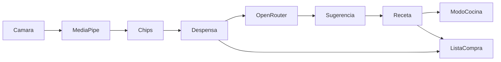

# Descubrimiento técnico

Decisiones técnicas de **What's for Lunch?**. Lo marcado **Confirmado** está fijado por el usuario; el resto es candidato. Las reglas del negocio viven en `docs/domain-model.md`; las validaciones pendientes en `docs/risks-and-open-questions.md` («Tareas de investigación»).

## Superficie del producto

App **Android nativa, solo móvil** (API 30 / Android 11 o superior), un solo repositorio (`P20`, `P24`, Q-arrancar-app-en-mis-recetas-2). Ocho pantallas: Mis Recetas (entrada, `P18`), Escáner, Detalle, Modo Cocina, Pinche, Formulario de Receta, Lista de la Compra y Ajustes. Sin web, tablet ni escritorio en el MVP.

## Punto de partida

El PRD de origen (`chefencasa_prd_y_project_brief_completo.md`) proponía una **PWA React 18/Vite/TS + Tailwind, backend Python FastAPI o Node.js con PostgreSQL, YOLOv8 ONNX y Gemini/Claude**. El usuario fijó un rumbo distinto en las rondas de descubrimiento:

- App **solo Android, Kotlin + Jetpack Compose**, un solo repositorio (`P35`, `P20`, `P24`).
- **Sin backend en el MVP**: datos locales, sesión local, sin cuentas (`P31`, `P33`). FastAPI queda como backend **futuro** (`P34`).
- Detección de alimentos con **Google AI Edge MediaPipe** en el dispositivo (`P23`).
- Asistente y sugerencias vía **API compatible con OpenAI** en **OpenRouter** (`P22`, `P36`).
- i18n es/en con estructura de recursos **`strings.xml`** (`P19`); documentación en español y código en inglés (`P25`).

El material de `uxdocs/` es **orientativo** (`P16`) y sus tokens YAML mandan sobre la prosa del propio archivo (`P17`).

## Stack candidato

| Capa | Candidato | Motivo | Alternativas | Estado |
|---|---|---|---|---|
| App | Kotlin + Jetpack Compose | Fijado por el usuario | — | **Confirmado** |
| i18n | Recursos `strings.xml` (es/en) | Estructura fijada por el usuario | — | **Confirmado** |
| Detección de alimentos | MediaPipe Tasks Vision Object Detector (on-device) | Fijado por el usuario; sustituye a YOLOv8 ONNX del PRD | TFLite directo, YOLOv8 ONNX | **Confirmado** · EfficientDet-Lite2, umbral de propuesta 0.60 (decisión del usuario, 2026-10-21; `RK02`) |
| Proveedor de IA (chat y sugerencias) | OpenRouter (API compatible con OpenAI) | Fijado por el usuario | Groq, Mistral, modelo local | **Confirmado** |
| Backend futuro | Python FastAPI (+ PostgreSQL) | Fijado por el usuario para la fase de sincronización | Node.js | **Confirmado** (fase posterior) |
| Datos locales | Room (SQLite) | Duradero en dispositivo, estándar Android | SQLDelight | En uso desde `crear-receta` (2.8.5 + KSP 2.3.12) |
| Cliente HTTP | Retrofit + OkHttp | Estándar para APIs REST desde Android | Ktor client | En uso (OkHttp también para la generación de imágenes) |
| Voz (locución y comandos) | `SpeechRecognizer` + `TextToSpeech` nativos | Equivalente nativo a la Web Speech API del PRD | Whisper on-device | **Candidato** (`⚠ S04`) |
| Arquitectura | MVVM + StateFlow, un módulo `app` con capas `ui`/`domain`/`data` | MVP de uso personal; separa reglas de negocio de la UI | MVI, multi-módulo | **Confirmado** (Q-arrancar-app-en-mis-recetas-1) |
| DI | Koin | Ligero y sin procesado de anotaciones | Hilt, inyección manual | **Confirmado** (Q-arrancar-app-en-mis-recetas-4) |
| Build | Gradle (Kotlin DSL) + Android Gradle Plugin 8.13.2, JDK 17 fijado en `gradle.properties` | Estándar Android | — | En uso desde `arrancar-app-en-mis-recetas` |
| Interfaz | Compose + Material 3 adaptado a los tokens de `uxdocs/DESIGN.md` | Material orientativo | XML Views | En uso desde `arrancar-app-en-mis-recetas` |

### Primer spike RK02: EfficientDet-Lite0 (2026-10-21)

- Modelo candidato: MediaPipe Tasks Vision Object Detector `efficientdet_lite0/float32/latest/efficientdet_lite0.tflite` (descarga oficial: `https://storage.googleapis.com/mediapipe-models/object_detector/efficientdet_lite0/float32/latest/efficientdet_lite0.tflite`), dependencia `com.google.mediapipe:tasks-vision:0.10.21`.
- Ejecución real en AVD Android API 30 / x86 (`MediaPipe_API30_x86`): la inicialización de Tasks Vision y la inferencia del modelo funcionaron; por tanto el runtime del modelo es compatible con API 30 en este entorno.
- Fixtures de alimentos y máxima confianza de la etiqueta correcta por imagen: banana `0.706`, manzanas `0.629`, brócoli `0.663`, pizza `0.834`. Media `0.7078` (70.78%); ninguna imagen supera 88%. EfficientDet-Lite0 no se seleccionó en este primer intento; por decisión del usuario se compararon alternativas antes de cerrar RK02.
- Fuentes de fixtures: Unsplash `photo-1571771894821-ce9b6c11b08e` (banana), `photo-1560806887-1e4cd0b6cbd6` (manzanas), Wikimedia Commons `Broccoli_and_cross_section_edit.jpg`, Unsplash `photo-1579751626657-72bc17010498` (pizza). La prueba instrumentada que registró los resultados fue `MediaPipeSpikeTest.efficientDetLite0DetectsFoodWithHighConfidenceOnDevice`.
- Incidencia de versión inicial: `tasks-vision:0.10.21` no incluía JNI x86_64 y su ABI ARM64 no funcionaba con páginas de 16 KiB. Se resolvió al usar `0.10.35`, que ejecuta el mismo Lite2 en API 37 x86_64 (ver resultado final abajo).

### Reintento RK02: modelos alternativos (2026-10-21)

Por decisión del usuario se compararon los cuatro modelos siguientes con el mismo MediaPipe Tasks Vision Object Detector `0.10.21`, en AVD API 30 x86 y con las mismas cuatro imágenes. Se registra la confianza máxima de la etiqueta COCO esperada en cada imagen y la media aritmética de esos cuatro valores. Todos cargaron e infirieron correctamente en API 30.

| Modelo `.tflite` | Fuente | Tamaño (bytes) | SHA-256 | Banana | Manzanas | Brócoli | Pizza | Media |
|---|---|---:|---|---:|---:|---:|---:|---:|
| EfficientDet-Lite0 float32 | [MediaPipe Models](https://storage.googleapis.com/mediapipe-models/object_detector/efficientdet_lite0/float32/latest/efficientdet_lite0.tflite) | 13,836,895 | `40338EDF5EC70D43E318B0A716A84D4564CD1802759A7A07170C7E43796DBF58` | 70.60% | 62.87% | 66.27% | 83.40% | 70.78% |
| EfficientDet-Lite1 (metadata) | [TensorFlow Task Library](https://storage.googleapis.com/download.tensorflow.org/models/tflite/task_library/object_detection/android/lite-model_efficientdet_lite1_detection_metadata_1.tflite) | 6,077,535 | `183AFA66AAD648B0DC16519AE1F55646D9CD38D2B544B917A9AB1DA320EBED75` | 71.88% | 58.59% | 70.31% | 75.39% | 69.04% |
| EfficientDet-Lite2 (metadata) | [TensorFlow Task Library](https://storage.googleapis.com/download.tensorflow.org/models/tflite/task_library/object_detection/android/lite-model_efficientdet_lite2_detection_metadata_1.tflite) | 7,557,887 | `6FD32C84AB1EB0F7E7F3A7A20A20D7DF1530DAA8378728F7C79571096286BD52` | 83.59% | 56.25% | 77.34% | 74.22% | 72.85% |
| SSD MobileNet V1 (metadata v2) | [TensorFlow Task Library](https://storage.googleapis.com/download.tensorflow.org/models/tflite/task_library/object_detection/android/lite-model_ssd_mobilenet_v1_1_metadata_2.tflite) | 4,185,175 | `CBDECD08B44C5DEA3821F77C5468E2936ECFBF43CDE0795A2729FDB43401E58B` | 76.56% | 64.45% | 76.56% | 62.11% | 69.92% |

**Resultado y decisión del usuario (2026-10-21):** ninguno alcanza `>88%` en las cuatro imágenes, pero se acepta EfficientDet-Lite2 con umbral mínimo **0.60**; la bandeja editable y RD05 son la red de seguridad. Lite2 alcanza media 72.85%, con scores correctos banana 83.59%, manzanas 56.25%, brócoli 77.34%, pizza 74.22%. Modelo final `app/src/main/assets/efficientdet_lite2_detection_metadata_1.tflite`, 7,557,887 bytes, SHA-256 `6FD32C84AB1EB0F7E7F3A7A20A20D7DF1530DAA8378728F7C79571096286BD52`, fuente TensorFlow Task Library enlazada en la tabla. No se probó YOLOv8 ni se degrada a manual.

Vocabulario COCO mostrado por esta implementación: diez clases alimentarias `apple`, `banana`, `broccoli`, `cake`, `carrot`, `donut`, `hot dog`, `orange`, `pizza`, `sandwich`; no se proponen las restantes clases COCO (personas, objetos, animales, etc.). `MediaPipeFoodDetector` filtra por esa lista y `food_label_*` da el nombre canónico es/en. El objeto `Detection` conserva caja normalizada para el HUD.

Dependencias finales: `com.google.mediapipe:tasks-vision:0.10.35` y CameraX `1.5.3` (`camera-core`, `camera-camera2`, `camera-lifecycle`, `camera-view`). El spike de scores se ejecutó inicialmente con Tasks Vision `0.10.21`; se actualizó el runtime a `0.10.35` porque el AAR anterior no incluía x86_64 y su ABI ARM64 fallaba con páginas de 16 KiB en `Pixel_10_Pro`. La API Object Detector y el modelo Lite2 no cambian. `MediaPipeFoodDetectorTest` pasó con el asset final en API 30 x86 y API 37 x86_64. `CameraXScanImageSourceTest` pasó en API 37 y verifica JPEG desde `ImageProxy` solo en memoria, sin `OutputFileOptions` ni archivos (RD06).

Las imágenes idénticas del protocolo son `banana.jpg` (SHA-256 `E133F498BFBDA0EB066A0B53BE007851E7AB82179BE3735AEE584A860C021706`), `apples.jpg` (`612919680DC0B8E0AD5700ACECD0B914DB8FA56AC5D78E0F715F0411258C4F9B`), `broccoli.jpg` (`9AC3C51C4F758A9AEB40FE32A234A14BA1A2157E96C0AC80E384BB18CED00FD4`) y `pizza.jpg` (`C368F4BACB38BDF19AA7586130A61234FF0B0AB4DA65E7E95AB7DA48A471D1D1`).

La comparación instrumentada fue `MediaPipeModelComparisonTest.comparesEfficientDetLiteModelsOnTheSameFoodImages`; el usuario aceptó el resultado de Lite2 con umbral 0.60. `MediaPipeFoodDetectorTest` pasó en API 30 x86 y API 37 x86_64 con Tasks Vision `0.10.35`; `CameraXScanImageSourceTest` verificó en API 37 JPEG en memoria sin archivos. No se probó un clasificador: no satisface el requisito de Object Detector con cajas/HUD y cambiaría la interacción especificada.

## Arquitectura y flujos

Módulo único `app/` con tres capas (estructura confirmada en Q-arrancar-app-en-mis-recetas-1, `⚠ S06`):

- `ui/` — pantallas Compose (Mis Recetas, Escáner, Detalle, Modo Cocina, Pinche, Formulario, Lista de la Compra, Ajustes).
- `domain/` — modelos y reglas (Coincidencia, escalado de Raciones, estados de Receta): sin dependencias de Compose.
- `data/` — Room (Despensa, Recetas, Lista de la Compra), cliente de OpenRouter y detección MediaPipe.

La UI no contiene reglas de negocio: viven en `domain/` y en `docs/domain-model.md` (IDs `RD##`).

Flujos principales: Escaneo → MediaPipe → chips confirmados → Despensa → Sugerencias (OpenRouter) → aceptar → Receta local → Detalle → Modo Cocina. Lista de la Compra se alimenta de faltantes de Recetas y de «Despensa baja».

## Datos y almacenamiento

- **Duraderos (Room)**: Recetas, Ingredientes, Alimentos de la Despensa, Ítems de la Lista de la Compra.
- **Temporales/derivados**: resultados de Escaneo (confianzas), fotos (no se persisten las de Escaneo — RD06; las de Receta se copian a `filesDir/recipes/<recipeId>.jpg`), caché de respuestas de la IA.
- **Credenciales**: API key en almacenamiento cifrado del dispositivo (Keystore / EncryptedSharedPreferences — **Candidato**), introducida por el usuario (`⚠ S05`).
- **Migración o importación**: ninguna (proyecto nuevo).

## Integraciones externas

- **OpenRouter (API compatible con OpenAI)** — chat del Pinche, Sugerencias de Recetas y generación de imágenes del Formulario. Llamadas desde el dispositivo con la API key del usuario en Ajustes (`⚠ S05`). Configuración «sin retención de datos» por RGPD (`P27`, `RK03`).
- **Google AI Edge MediaPipe** — inferencia on-device; no requiere red.

## Autenticación y autorización

No hay cuentas, login ni sesión en red (`P31`): la app es local y su único usuario es quien usa el dispositivo (ver «Roles y acceso» de `docs/domain-model.md`). No hay control de acceso por recursos, ni permisos que conceder, revocar ni que caduquen. La única credencial del sistema es la **API key de IA**, que aporta el propio usuario (`⚠ S05`).

## Despliegue y operación

- Distribución por **APK instalada a mano** (`P28`); sin Play Store en el MVP.
- Mantenimiento y operación: el propio usuario (uso personal, 1-5 usuarios).

## Pruebas y verificación

- **Unitarias**: JUnit sobre `domain/` y `data/` con cliente de IA simulado (**Candidato**: JUnit5 + coroutines-test).
- **E2E**: pruebas instrumentadas Compose sobre emulador (`connectedDebugAndroidTest`), cubriendo el flujo Escaneo → Receta → Modo Cocina con fixtures locales de alimentos/recetas y IA falsa.
- **Mediciones puntuales**: `adb` + uiautomator (tamaños, jerarquía, capturas); capturas en español con locale por aplicación.
- **Comandos** (Gradle Kotlin DSL con el wrapper del repo; los scripts `init`/`lint`/`unit`/`e2e` del harness los envuelven):
  - Arrancar (compilar e instalar en dispositivo/emulador): `./gradlew installDebug`
  - Compilar: `./gradlew assembleDebug`
  - Tests unitarios: `./gradlew testDebugUnitTest`
  - Lint: `./gradlew lintDebug`
  - Instrumentados/E2E: `./gradlew connectedDebugAndroidTest`

Cuándo se considera terminada una funcionalidad y qué significa cada estado: `AGENTS.md`.

## Observabilidad

Mínima en el MVP: logs locales de la app, sin telemetría ni alertas (`⚠ S01`). Si se quiere métrica de uso (retención, sesiones), hoy se mide manualmente (`RK06`).

## Seguridad y datos sensibles

- PII: no hay cuentas ni datos de identidad; los alimentos de la Despensa y las fotos son sensibles por contexto.
- RGPD: las fotos del Escaneo se procesan y se descartan (RD06); proveedor sin retención para entrenamiento; aviso al usuario (`P27`).
- API key: nunca en el repositorio ni hardcodeada; solo en almacenamiento cifrado del dispositivo (`⚠ S05`).

## Restricciones

- Rendimiento: arranque rápido; inferencia de visión < 800 ms como objetivo del PRD (**Por validar** en dispositivo real).
- Accesibilidad: contraste WCAG 2.1 AA general y AAA en Modo Cocina; áreas táctiles ≥ 48×48 px.
- Offline: toda la app funciona sin red salvo el Pinche y las Sugerencias (requieren OpenRouter).
- Internacionalización: es y en vía `strings.xml`, sin más regionalización (`P12` eliminó precios).
- Plataforma: **Android 11 (API 30) o superior**, solo móviles (Q-arrancar-app-en-mis-recetas-2).
- Sin fecha límite ni presupuesto de IA definido (`P3`, `P30`).
