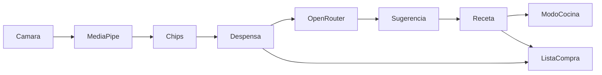

# Descubrimiento técnico

Decisiones técnicas de **What's for Lunch?**. Lo marcado **Confirmado** está fijado por el usuario; el resto es candidato. Las reglas del negocio viven en `docs/domain-model.md`; las validaciones pendientes en `docs/risks-and-open-questions.md` («Tareas de investigación»).

## Superficie del producto

App **Android nativa, solo móvil** (API 30 / Android 11 o superior), un solo repositorio (`P20`, `P24`, Q-arrancar-app-en-mis-recetas-2). Ocho pantallas: Mis Recetas (entrada, `P18`), Escáner, Detalle, Modo Cocina, Pinche, Formulario de Receta, Lista de la Compra y Ajustes. Sin web, tablet ni escritorio en el MVP.

## Punto de partida

El PRD de origen (`chefencasa_prd_y_project_brief_completo.md`) proponía una **PWA React 18/Vite/TS + Tailwind, backend Python FastAPI o Node.js con PostgreSQL, YOLOv8 ONNX y Gemini/Claude**. El usuario fijó un rumbo distinto en las rondas de descubrimiento:

- App **solo Android, Kotlin + Jetpack Compose**, un solo repositorio (`P35`, `P20`, `P24`).
- **Sin backend en el MVP**: datos locales, sesión local, sin cuentas (`P31`, `P33`). FastAPI queda como backend **futuro** (`P34`).
- Detección de alimentos con **Google AI Edge MediaPipe** en el dispositivo (`P23`).
- Asistente y sugerencias vía **API compatible con OpenAI** en **OpenRouter** (`P22`, `P36`).
- i18n es/en con estructura de recursos **`strings.xml`** (`P19`); documentación en español y código en inglés (`P25`).

El material de `uxdocs/` es **orientativo** (`P16`) y sus tokens YAML mandan sobre la prosa del propio archivo (`P17`).

## Stack candidato

| Capa | Candidato | Motivo | Alternativas | Estado |
|---|---|---|---|---|
| App | Kotlin + Jetpack Compose | Fijado por el usuario | — | **Confirmado** |
| i18n | Recursos `strings.xml` (es/en) | Estructura fijada por el usuario | — | **Confirmado** |
| Detección de alimentos | Google AI Edge MediaPipe (on-device) | Fijado por el usuario; sustituye a YOLOv8 ONNX del PRD | TFLite directo, YOLOv8 ONNX | **Confirmado** (familia) · modelo concreto **Por validar** (`RK02`) |
| Proveedor de IA (chat y sugerencias) | OpenRouter (API compatible con OpenAI) | Fijado por el usuario | Groq, Mistral, modelo local | **Confirmado** |
| Backend futuro | Python FastAPI (+ PostgreSQL) | Fijado por el usuario para la fase de sincronización | Node.js | **Confirmado** (fase posterior) |
| Datos locales | Room (SQLite) | Duradero en dispositivo, estándar Android | SQLDelight | En uso desde `crear-receta` (2.8.5 + KSP 2.3.12) |
| Cliente HTTP | Retrofit + OkHttp | Estándar para APIs REST desde Android | Ktor client | En uso (OkHttp también para la generación de imágenes) |
| Voz (locución y comandos) | `SpeechRecognizer` + `TextToSpeech` nativos | Equivalente nativo a la Web Speech API del PRD | Whisper on-device | **Candidato** (`⚠ S04`) |
| Arquitectura | MVVM + StateFlow, un módulo `app` con capas `ui`/`domain`/`data` | MVP de uso personal; separa reglas de negocio de la UI | MVI, multi-módulo | **Confirmado** (Q-arrancar-app-en-mis-recetas-1) |
| DI | Koin | Ligero y sin procesado de anotaciones | Hilt, inyección manual | **Confirmado** (Q-arrancar-app-en-mis-recetas-4) |
| Build | Gradle (Kotlin DSL) + Android Gradle Plugin 8.13.2, JDK 17 fijado en `gradle.properties` | Estándar Android | — | En uso desde `arrancar-app-en-mis-recetas` |
| Interfaz | Compose + Material 3 adaptado a los tokens de `uxdocs/DESIGN.md` | Material orientativo | XML Views | En uso desde `arrancar-app-en-mis-recetas` |

## Arquitectura y flujos

Módulo único `app/` con tres capas (estructura confirmada en Q-arrancar-app-en-mis-recetas-1, `⚠ S06`):

- `ui/` — pantallas Compose (Mis Recetas, Escáner, Detalle, Modo Cocina, Pinche, Formulario, Lista de la Compra, Ajustes).
- `domain/` — modelos y reglas (Coincidencia, escalado de Raciones, estados de Receta): sin dependencias de Compose.
- `data/` — Room (Despensa, Recetas, Lista de la Compra), cliente de OpenRouter y detección MediaPipe.

La UI no contiene reglas de negocio: viven en `domain/` y en `docs/domain-model.md` (IDs `RD##`).

Flujos principales: Escaneo → MediaPipe → chips confirmados → Despensa → Sugerencias (OpenRouter) → aceptar → Receta local → Detalle → Modo Cocina. Lista de la Compra se alimenta de faltantes de Recetas y de «Despensa baja».

## Datos y almacenamiento

- **Duraderos (Room)**: Recetas, Ingredientes, Alimentos de la Despensa, Ítems de la Lista de la Compra.
- **Temporales/derivados**: resultados de Escaneo (confianzas), fotos (no se persisten las de Escaneo — RD06; las de Receta se copian a `filesDir/recipes/<recipeId>.jpg`), caché de respuestas de la IA.
- **Credenciales**: API key en almacenamiento cifrado del dispositivo (Keystore / EncryptedSharedPreferences — **Candidato**), introducida por el usuario (`⚠ S05`).
- **Migración o importación**: ninguna (proyecto nuevo).

## Integraciones externas

- **OpenRouter (API compatible con OpenAI)** — chat del Pinche, Sugerencias de Recetas y generación de imágenes del Formulario. Llamadas desde el dispositivo con la API key del usuario en Ajustes (`⚠ S05`). Configuración «sin retención de datos» por RGPD (`P27`, `RK03`).
- **Google AI Edge MediaPipe** — inferencia on-device; no requiere red.

## Autenticación y autorización

No hay cuentas, login ni sesión en red (`P31`): la app es local y su único usuario es quien usa el dispositivo (ver «Roles y acceso» de `docs/domain-model.md`). No hay control de acceso por recursos, ni permisos que conceder, revocar ni que caduquen. La única credencial del sistema es la **API key de IA**, que aporta el propio usuario (`⚠ S05`).

## Despliegue y operación

- Distribución por **APK instalada a mano** (`P28`); sin Play Store en el MVP.
- Mantenimiento y operación: el propio usuario (uso personal, 1-5 usuarios).

## Pruebas y verificación

- **Unitarias**: JUnit sobre `domain/` y `data/` con cliente de IA simulado (**Candidato**: JUnit5 + coroutines-test).
- **E2E**: pruebas instrumentadas Compose sobre emulador (`connectedDebugAndroidTest`), cubriendo el flujo Escaneo → Receta → Modo Cocina con fixtures locales de alimentos/recetas y IA falsa.
- **Mediciones puntuales**: `adb` + uiautomator (tamaños, jerarquía, capturas); capturas en español con locale por aplicación.
- **Comandos** (Gradle Kotlin DSL con el wrapper del repo; los scripts `init`/`lint`/`unit`/`e2e` del harness los envuelven):
  - Arrancar (compilar e instalar en dispositivo/emulador): `./gradlew installDebug`
  - Compilar: `./gradlew assembleDebug`
  - Tests unitarios: `./gradlew testDebugUnitTest`
  - Lint: `./gradlew lintDebug`
  - Instrumentados/E2E: `./gradlew connectedDebugAndroidTest`

Cuándo se considera terminada una funcionalidad y qué significa cada estado: `AGENTS.md`.

## Observabilidad

Mínima en el MVP: logs locales de la app, sin telemetría ni alertas (`⚠ S01`). Si se quiere métrica de uso (retención, sesiones), hoy se mide manualmente (`RK06`).

## Seguridad y datos sensibles

- PII: no hay cuentas ni datos de identidad; los alimentos de la Despensa y las fotos son sensibles por contexto.
- RGPD: las fotos del Escaneo se procesan y se descartan (RD06); proveedor sin retención para entrenamiento; aviso al usuario (`P27`).
- API key: nunca en el repositorio ni hardcodeada; solo en almacenamiento cifrado del dispositivo (`⚠ S05`).

## Restricciones

- Rendimiento: arranque rápido; inferencia de visión < 800 ms como objetivo del PRD (**Por validar** en dispositivo real).
- Accesibilidad: contraste WCAG 2.1 AA general y AAA en Modo Cocina; áreas táctiles ≥ 48×48 px.
- Offline: toda la app funciona sin red salvo el Pinche y las Sugerencias (requieren OpenRouter).
- Internacionalización: es y en vía `strings.xml`, sin más regionalización (`P12` eliminó precios).
- Plataforma: **Android 11 (API 30) o superior**, solo móviles (Q-arrancar-app-en-mis-recetas-2).
- Sin fecha límite ni presupuesto de IA definido (`P3`, `P30`).
