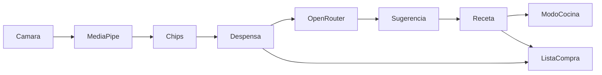

# Descubrimiento técnico

Exploración inicial. Nada de lo siguiente está decidido salvo lo marcado como **Confirmado**.

## Punto de partida

Proyecto desde cero (solo hay PRD y material UX). El PRD de origen (`chefencasa_prd_y_project_brief_completo.md`) proponía una **PWA React 18/Vite/TS + Tailwind, backend Python FastAPI o Node.js con PostgreSQL, YOLOv8 ONNX y Gemini/Claude**. El usuario fijó un rumbo distinto en las rondas de descubrimiento:

- App **solo Android, Kotlin + Jetpack Compose**, un solo repositorio (`P35`, `P20`, `P24`).
- **Sin backend en el MVP**: datos locales, sesión local, sin cuentas (`P31`, `P33`). FastAPI queda como backend **futuro** (`P34`).
- Detección de alimentos con **Google AI Edge MediaPipe** en el dispositivo (`P23`).
- Asistente y sugerencias vía **API compatible con OpenAI** en **OpenRouter** (`P22`, `P36`).
- i18n es/en con estructura de recursos **`strings.xml`** (`P19`); documentación en español y código en inglés (`P25`).

El material de `uxdocs/` es **orientativo** (`P16`) y sus tokens YAML mandan sobre la prosa del propio archivo (`P17`).

## Stack candidato

| Capa | Candidato | Motivo | Alternativas | Estado |
|---|---|---|---|---|
| App | Kotlin + Jetpack Compose | Fijado por el usuario | — | **Confirmado** |
| i18n | Recursos `strings.xml` (es/en) | Estructura fijada por el usuario | — | **Confirmado** |
| Detección de alimentos | Google AI Edge MediaPipe (on-device) | Fijado por el usuario; sustituye a YOLOv8 ONNX del PRD | TFLite directo, YOLOv8 ONNX | **Confirmado** (familia) · modelo concreto **Por validar** |
| Proveedor de IA (chat y sugerencias) | OpenRouter (API compatible con OpenAI) | Fijado por el usuario | Groq, Mistral, modelo local | **Confirmado** |
| Backend futuro | Python FastAPI (+ PostgreSQL) | Fijado por el usuario para la fase de sincronización | Node.js | **Confirmado** (fase posterior) |
| Datos locales | Room (SQLite) | Duradero en dispositivo, estándar Android | SQLDelight | **Candidato** |
| Cliente HTTP | Retrofit + OkHttp | Estándar para APIs REST desde Android | Ktor client | **Candidato** |
| Voz (locución y comandos) | `SpeechRecognizer` + `TextToSpeech` nativos | Equivalente nativo a la Web Speech API del PRD | Whisper on-device | **Candidato** |
| Arquitectura | MVVM + StateFlow, un módulo `app` con capas `ui`/`domain`/`data` | MVP de uso personal; separa reglas de negocio de la UI | MVI, multi-módulo | **Confirmado** |
| DI | Koin | Ligero y sin procesado de anotaciones; elegido en Q-arrancar-app-en-mis-recetas-4 | Hilt, inyección manual | **Confirmado** |
| Build | Gradle (Kotlin DSL) + Android Gradle Plugin | Estándar Android | — | **Candidato** |
| Interfaz | Compose + Material 3 adaptado a los tokens de `uxdocs/DESIGN.md` | Material orientativo | XML Views | **Candidato** |

## Arquitectura y flujos

Módulo único `app/` con tres capas (`⚠ S06`: estructura prevista, el repo aún no tiene código):

- `ui/` — pantallas Compose (Mis Recetas, Escáner, Detalle, Modo Cocina, Pinche, Formulario, Lista de la Compra, Ajustes).
- `domain/` — modelos y reglas (Coincidencia, escalado de Raciones, estados de Receta): sin dependencias de Compose.
- `data/` — Room (Despensa, Recetas, Lista de la Compra), cliente de OpenRouter y detección MediaPipe.

Flujos principales: Escaneo → MediaPipe → chips confirmados → Despensa → Sugerencias (OpenRouter) → aceptar → Receta local → Detalle → Modo Cocina. Lista de la Compra se alimenta de faltantes de Recetas y de «Despensa baja».

## Integraciones externas

- **OpenRouter (API compatible con OpenAI)** — chat del Pinche y Sugerencias de Recetas. Llamadas desde el dispositivo con la API key del usuario en Ajustes (`⚠ S05`). Configuración «sin retención de datos» por RGPD (`P27`, `RK03`).
- **Google AI Edge MediaPipe** — inferencia on-device; no requiere red.

## Datos y persistencia

- **Duraderos (Room)**: Recetas, Ingredientes, Alimentos de la Despensa, Ítems de la Lista de la Compra.
- **Temporales/derivados**: resultados de Escaneo (confianzas), fotos (no se persisten — RD06), caché de respuestas de la IA.
- **Credenciales**: API key en almacenamiento cifrado del dispositivo (Keystore / EncryptedSharedPreferences — **Candidato**), introducida por el usuario (`⚠ S05`).
- **Migración o importación**: ninguna (proyecto nuevo).

## Requisitos no funcionales

- Rendimiento: arranque rápido; inferencia de visión < 800 ms como objetivo del PRD (**Por validar** en dispositivo real).
- Accesibilidad: contraste WCAG 2.1 AA general y AAA en Modo Cocina; áreas táctiles ≥ 48×48 px.
- Offline: toda la app funciona sin red salvo el Pinche y las Sugerencias (requieren OpenRouter).
- Internacionalización: es y en vía `strings.xml`, sin más regionalización (`P12` eliminó precios).
- Plataforma: **Android 11 (API 30) o superior**, solo móviles (Q-arrancar-app-en-mis-recetas-2).

## Seguridad y datos sensibles

- PII: no hay cuentas ni datos de identidad; los alimentos de la Despensa y las fotos son sensibles por contexto.
- RGPD: las fotos se procesan y se descartan (RD06); proveedor sin retención para entrenamiento; aviso al usuario (`P27`).
- API key: nunca en el repositorio ni hardcodeada; solo en almacenamiento cifrado del dispositivo (`⚠ S05`).

## Operación y despliegue

- Distribución por **APK instalada a mano** (`P28`); sin Play Store en el MVP.
- Mantenimiento: el propio usuario.
- Observabilidad: mínima (logs locales); métricas y alertas después (`⚠ S01`).

## Verificación

- Unitarias: JUnit sobre `domain/` y `data/` con cliente de IA simulado (**Candidato**: JUnit5 + coroutines-test).
- E2E: pruebas instrumentadas Compose sobre emulador (`connectedDebugAndroidTest`), cubriendo el flujo Escaneo → Receta → Modo Cocina con fixtures locales de alimentos/recetas y IA falsa. Comandos y validaciones previas a dar algo por terminado: `CONTEXT.md`.

## A validar antes de construir

- Modelo MediaPipe concreto que detecte alimentos con la confianza objetivo (> 88%) (`RK02`).
- Latencia y coste reales de OpenRouter para chat y sugerencias (`RK01`).
- Compatibilidad de MediaPipe con la versión mínima de Android que se fije.
- Configuración efectiva de «sin retención» en OpenRouter (`RK03`).
- Permisos de cámara y micrófono y su flujo en Android (`⚠ S04` implica APIs nativas de voz).
